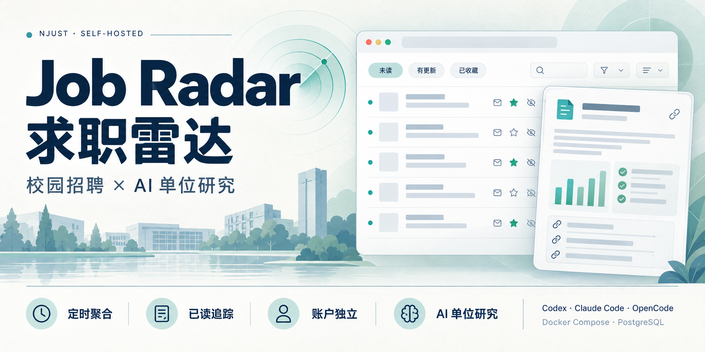

# Job Radar · 求职雷达



Self-hosted campus recruitment inbox with per-user reading states and AI employer research powered by Codex, Claude Code, or OpenCode.

一个可自托管、支持多账户的招聘信息收件箱。它将南京理工大学就业服务平台的公开宣讲会和招聘会（双选会）数据定时保存到本地 PostgreSQL，记录首次发现、内容版本、已读、收藏、隐藏和备注，并提供筛选、排序与一次性 AI 单位研究。

当前版本 `0.2.0`，使用 MIT 许可证。已内置南京理工大学的宣讲会和招聘会两个数据源；独立“招聘公告/岗位”栏目及其他高校尚未接入，外部数据可通过受保护的批量导入 API 接入。

> 适合希望持续跟进校园招聘、不想反复翻找旧信息的个人或可信小团队。普通聚合与浏览不需要 AI；AI 单位研究是可选功能，需额外安装并授权宿主机 CLI。顶部海报是功能概念图，不是真实数据截图。

## 导航

- [招聘信息来源](#招聘信息来源)
- [功能](#功能) · [日常使用指南](#日常使用指南) · [账户与权限](#账户与权限)
- [目录与容器](#目录与容器) · [首次部署](#首次部署) · [配置速查](#配置速查)
- [推荐的 HTTPS 配置](#推荐的-https-配置) · [同步配置](#同步配置)
- [一次性 AI 单位研究](#一次性-ai-单位研究) · [管理后台指南](#管理后台指南)
- [API](#api) · [更新应用](#更新应用) · [备份与恢复](#备份与恢复)
- [常见问题](#常见问题) · [本地开发与测试](#本地开发与测试)
- [来源与使用边界](#来源与使用边界) · [开源与发布](#开源与发布)

## 招聘信息来源

默认自动同步的招聘信息来自 **[南京理工大学就业服务平台（91job 学校分站）](https://njust.91job.org.cn/)**，学校代码为 `10288`。当前内置以下两个公开栏目：

| 数据类别 | 来源页面 | 本站来源标识 |
|---|---|---|
| 宣讲会（包括线上、线下） | [南京理工大学 · 宣讲会列表](https://njust.91job.org.cn/sub-station/lectureList?xxdm=10288&lmid=053399A3DEF5F6A0E0630100007F3366) | `njust-91job` |
| 招聘会 / 双选会（包括线上、线下） | [南京理工大学 · 招聘会列表](https://njust.91job.org.cn/sub-station/recruitList?xxdm=10288&lmid=053399A3DEF6F6A0E0630100007F3366) | `njust-91job-recruitment` |

获取方式由 [南京理工来源适配器](radar/services/njust.py) 实现：使用上述页面所调用的公开 JSON 分页接口，而不是抓取搜索引擎摘要或由 AI 生成招聘公告。宣讲会列表对应 `POST /web/wsjysc/lbxq/getXjhPageList`，招聘会列表对应 `POST /web/wsjysc/lbxq/getZphPageList`；同步时逐页读取、规范化后入库。默认仅获取列表字段，设置 `FETCH_DETAILS=true` 后会额外请求来源详情接口。

每条记录保留来源类别、来源记录 ID 和原始详情页链接，详情中的“在原始网站查看”可直接回到上游核验。本站是非官方聚合与阅读工具，不代表学校或用人单位背书；时间、地点、岗位要求及后续变动请以来源网站和用人单位公告为准。

**覆盖范围说明：**“招聘会 / 双选会”不等于独立“招聘公告 / 岗位”栏目，后者当前未接入；南京大学、东南大学、南京航空航天大学、南京邮电大学等其他高校也尚无内置适配器。若部署者通过通用导入 API 添加其他来源，列表会显示其来源记录，但不表示项目已提供该来源的自动抓取器。

**AI 研究资料是另一类来源：**招聘条目来自上述平台，附加的“单位研究快照”由所选 AI 工具另外联网检索年报、交易所公告、单位官网等公开资料，并在快照中逐项列出实际来源链接。AI 研究结果不是招聘公告原文，也不是学校或单位的官方结论。

## 功能

### 招聘信息收件箱

- 每天三次自动同步，也可由管理员从页面、命令行或 API 手动触发；重复抓取以来源记录 ID 幂等更新。
- 宣讲会与招聘会独立保存，可按来源分别筛选，互不影响失效判定。
- 快速切换新出现、有更新、未读、即将举办、已结束、收藏和隐藏视图。
- 支持单位/标题/地点/学校关键词、线上/线下/未知形式及举办日期范围筛选。
- 提供未读优先、举办时间正序/倒序、首次发现、最近变更、标题和单位排序；每页 25 条，翻页保留筛选条件。

### 阅读进度与变化追踪

- 已读进度记录到内容版本，而不只是一个勾选状态；读过的条目发生实质变化后会重新进入“有更新”。
- 列表“已读”原位更新，不滚回页首；详情页自动标记当前版本为已读，并提供返回刚才列表的入口。
- 收藏、隐藏、重新标为未读和私人备注均按账户保存，不会覆盖其他用户的操作。
- 可将昨天及以前的未读批量整理为已读，前端连续两次确认且服务端校验确认标记。
- 详情页展示最近 20 次字段级变化及“原来 → 现在”对比，并区分自上次阅读以来的变化。
- 仅来源状态变化时不增加内容版本或制造“内容更新”提醒；连续缺失达到阈值后标记失效，不物理删除历史信息。

### 面向求职者的 AI 单位研究

- Codex（默认）、Claude Code、OpenCode 三种宿主机 CLI 可选，共用研究 Prompt 和结构化输出校验。
- 研究实际招聘主体、业务组成、母子公司与隶属链；有可靠证据时说明单位层级，并区分行政级别与集团层级。
- 对确认的上市主体整理最近三个已披露完整财年的收入、成本、费用、研发费用和归母净利润，要求注明币种、单位与财务主体。
- 提供发展驱动、风险、不确定性、求职关注点与可点击来源；无法确认的信息会明确列出，而不是填补猜测。
- 新条目可自动入队；后台支持按日期补齐或覆盖总结，预览与最终确认后才入队，实际执行由 Worker 完成。
- 详情展示生成时点、工具/模型、置信度及输入/输出 Token；已有快照直接读取数据库，浏览页面不会反复调用 AI。

### 自托管与扩展

- `app + PostgreSQL` 两个容器，Docker Compose 启动；数据库不暴露宿主机端口，持久数据保存在卷中。
- 内置用户管理、同步日志、字段变更记录、研究任务与快照管理。
- 提供招聘数据查询、手动同步、通用导入、用户状态与 AI 任务 API，便于接入自己的抓取器。
- 包含测试、GitHub Actions CI、MIT License 和源码白名单发布脚本；示例环境、代码、文档及海报可一同打包。

## 日常使用指南

### 第一次打开与每天继续阅读

1. 使用管理员分配的账户登录；首页 `/` 是招聘收件箱，登录页为 `/accounts/login/`。
2. 先选“未读”处理所有待看内容，或选“新出现”只看自己从未读过的条目。需要识别刚入库的数据时，选择“首次发现：最新优先”。
3. 用关键词、来源、形式和举办日期缩小范围，再切换排序。形式、来源和排序选择后自动提交；关键词及日期修改后点击“应用”。
4. 打开详情会自动读到当前版本；不想打开时，在列表点击“已读”即可原位处理。返回列表的入口会保留刚才的筛选与页码，不承诺恢复像素级滚动位置。
5. 对感兴趣的条目收藏，在详情页记录准备事项、投递进度或待询问的问题，并点击“保存备注”。
6. 下次登录先看“新出现”和“有更新”，无需记住上次在源站翻到哪里。阅读进度保存在数据库，换设备登录同一账户也可继续使用。

“新出现”表示**当前账户尚无已读版本**，不等于“今天发布”；“首次发现”是本站首次入库时间，也不等于上游发布日期。“即将举办”按举办日期包含今天，“已结束”按日期早于今天判断，并非按精确结束时分或源站状态判断。

### 读过之后为什么又出现“有更新”

例如你读到 `v1`，随后同步发现举办时间或地点改变，条目会变成 `v2`；它对你来说再次未读，并出现在“有更新”。从未读过此条目的其他账户仍会看到“新出现”。详情里的“具体更新内容”会列出已记录的旧值、新值与变化时间。

仅“未举办 → 已举办”等来源状态变化不会触发此提醒；同步日志中的“更新”数量仍可能包含这类状态更新。启用字段级记录前的旧版本没有旧值，页面会明确提示无法还原，不会编造差异。

### 隐藏、取消隐藏与历史未读整理

- “隐藏”只从你自己的常用视图移走条目；到“隐藏”视图打开详情，再点击“取消隐藏”可恢复。不会删除公共招聘数据。
- “重新标为未读”可把当前版本放回待处理状态。已有阅读版本的条目重新标为未读后，也可能归入“有更新”，因为视图按版本差判断。
- “整理昨天及以前未读”按**举办日期**截至昨天选择，不按发布日期或首次入库日期；没有举办日期、今天及未来的条目不在范围内。
- 该批量操作覆盖当前账户下所有符合条件的有效条目，**不只当前页，也不受当前关键词、来源或隐藏筛选限制**；已隐藏的符合条件条目也包括在内。
- 连续两次确认后标记为已读，保留收藏、隐藏和备注，不影响其他账户；没有一键撤销，需要时逐条重新标为未读。请先核对按钮上的数量。

### 怎样阅读 AI 研究结果

在条目详情中查看“单位研究快照”：先确认实际招聘单位，再看业务组成、隶属关系、可核验的财务信息和“站在求职者角度”的分析。关键结论应打开来源复核，尤其要区分母集团、上市主体与具体招聘子公司。

快照可能显示等待中、研究中或失败；没有快照也没有任务时，不会自动在你点击页面时开始研究。非上市单位可以没有财务表，未确认的层级不应被当作已核验事实。默认没有你的专业、经历或偏好输入，因此它提供的是一般求职关注点，而不是个人匹配打分或投资建议。

## 账户与权限

没有公开自助注册、邮件找回密码或独立租户空间。管理员在 `/admin/` 的“认证和授权 → 用户”中为可信用户创建账户；普通浏览用户不需要设置为工作人员或超级用户。

| 身份或凭据 | 当前能力与边界 |
|---|---|
| 普通登录用户 | 浏览共享招聘数据和共享 AI 快照；操作自己的已读、收藏、隐藏、备注。当前通用 API 也允许已登录账户查询、触发同步及导入。 |
| 工作人员 | 可使用页面“立即同步”；进入后台后能操作哪些模型，仍取决于 Django 授予的模型权限。日期批量 AI 研究需要任务新增权限。 |
| 超级用户 | 管理所有模型与用户，包含各账户状态和备注；不要把超级用户分配给普通浏览者。 |
| `APP_API_TOKEN` | 系统级凭据，可调用通用接口与 AI 任务接口；不代表某个用户，不能单独用于修改个人状态。 |

账户独立指普通用户操作互不覆盖，**不意味着管理员无法访问备注或具备加密的租户隔离**。当前登录用户可调用有共享写入影响的通用 API，因此仅适合可信用户环境，不应把账号随意发放给陌生人。

修改默认管理员密码可使用下列命令；如果首次用户名不是 `admin`，替换为自己的用户名：

```bash
docker compose exec app python manage.py changepassword admin
```

## 目录与容器

项目只需要两个容器：

- `app`：Django、Gunicorn、页面、API、定时同步和管理后台，容器内监听 8000。
- `db`：PostgreSQL 17，仅连接 Docker 内部网络，数据保存到 `postgres_data` 卷。

可选的 AI Worker 不在上述两个容器里：它在宿主机以独立用户运行，领取研究任务、调用所选 CLI，再通过 Token 接口回传结果。关闭 AI 时不需要这个进程，前端浏览也不依赖宿主机安装 AI 工具。

```text
来源公开接口 → app 定时同步 → PostgreSQL ← app 页面/API ← 浏览器
                                      ↑
                         可选宿主机 Worker ↔ AI CLI / 公开网页
```

实现与验收清单见 [TODO.md](TODO.md)。

```text
config/                    Django 配置
radar/                     模型、网页/API、同步与测试
templates/                 页面模板
prompts/employer_research.txt  三个后端共用的研究 Prompt
research.schema.json       研究输出结构
tools/ai_research_worker.py 通用宿主机 Worker
tools/research_providers.py CLI 适配与结果校验
tools/package_release.py   生成干净开源目录及部署包
deploy/                    用户级 systemd 服务及定时器
docs/assets/               README 介绍海报（不含真实页面数据）
```

## 首次部署

### 1. 获取源码与准备环境

服务器需已安装 Docker Engine 和支持本 Compose 文件的 Docker Compose v2，能访问镜像源、Python 包源和招聘来源网站。仅使用聚合功能时，不需要 Node.js、AI API Key 或独立任务队列服务。

```bash
git clone https://github.com/qq1018408006/NJUST-job-radar.git
cd NJUST-job-radar
cp .env.example .env
```

如果使用源码压缩包，解压后进入同时包含 `docker-compose.yml`、`Dockerfile` 和 `.env.example` 的目录即可，不必重新克隆。后续 Compose 和 Worker 命令均从项目根目录执行。

### 2. 配置必要参数

编辑 `.env`，至少修改：

- `DJANGO_SECRET_KEY`
- `DJANGO_SUPERUSER_PASSWORD`
- `APP_API_TOKEN`
- `POSTGRES_PASSWORD`
- `ALLOWED_HOSTS`：填写服务器 IP 或域名，多个值用逗号分隔
- `CSRF_TRUSTED_ORIGINS`：使用 HTTPS 域名时填写完整来源，例如 `https://jobs.example.com`

可多次运行以下命令，为不同密钥/密码分别生成随机值；不要将结果提交到仓库：

```bash
python3 -c 'import secrets; print(secrets.token_urlsafe(48))'
```

数据库密码请使用 URL 安全字符（字母、数字、`-`、`_`）。示例默认 `AI_RESEARCH_ENABLED=false`，建议先确认聚合与登录正常，再启用 AI。

### 3. 启动并检查

```bash
docker compose config --quiet
docker compose up -d --build
docker compose ps
docker compose logs --tail=100 app
curl --fail http://127.0.0.1:8080/healthz
```

健康接口成功返回 `ok`，同时检查 `app` 与 `db` 是否 healthy。需要持续观察首次同步时：

```bash
docker compose logs -f app
```

默认访问地址：`http://服务器地址:8080`。端口可通过 `.env` 中的 `WEB_PORT` 修改。

Compose 当前将 Web 端口发布到所有宿主机接口，Gunicorn 在容器内监听 `0.0.0.0:8000`；请使用防火墙控制访问范围。只经同机反向代理访问时，可把 Compose 的端口映射改为 `127.0.0.1:${WEB_PORT:-8080}:8000`。容器内服务绑定 `0.0.0.0` 与宿主机是否对外开放端口是两件事。

首次启动会自动：

1. 等待 PostgreSQL 健康；
2. 执行数据库迁移；
3. 收集静态资源；
4. 创建环境变量指定的管理员；
5. 启动定时器和 Web 服务；
6. 在 `RUN_SYNC_ON_STARTUP=true` 时立即完成首次同步。

首次管理员只会在账号不存在时创建，容器重启不会重置其密码。

### 4. 登录与建立阅读账户

访问 `/` 或 `/accounts/login/`，用 `.env` 中配置的初始账户登录；在 `/admin/` 创建日常浏览账户。关闭容器或执行普通 `docker compose down` 不会删除数据库卷，但**不要执行 `docker compose down -v`，除非你确实要删除全部持久数据**。

## 配置速查

完整可配置项及占位值见 [.env.example](.env.example)。下表是常用项；实际值应保留在忽略提交的 `.env` 中。

| 配置 | 用途与默认行为 |
|---|---|
| `WEB_PORT` | 宿主机 Web 端口，示例为 `8080`；修改后也检查 Worker 地址与反向代理。 |
| `ALLOWED_HOSTS` | 允许的主机名/IP，逗号分隔，不带协议、路径或端口；公网不要长期使用 `*`。 |
| `CSRF_TRUSTED_ORIGINS` | 完整可信来源，含 `http://` 或 `https://`，非标准端口也要包含。 |
| `DJANGO_SECRET_KEY`、`APP_API_TOKEN` | 分别用于应用签名和系统 API 鉴权，需设置不同的长随机值。 |
| `DJANGO_SUPERUSER_*` | 仅首次创建管理员，不用于重置已存在账户。 |
| `POSTGRES_DB`、`POSTGRES_USER`、`POSTGRES_PASSWORD` | 数据库名称和凭据；已有卷的初始化信息不会随 `.env` 修改自动变更。 |
| `TIME_ZONE`、`SYNC_SCHEDULE` | 时区和每日同步时刻，示例 `Asia/Shanghai`、`08:00,13:00,20:00`。 |
| `SYNC_ENABLED`、`RUN_SYNC_ON_STARTUP` | 是否启动自动同步，以及调度器启动后是否立即同步一次，示例均为 `true`。 |
| `SYNC_PAGE_SIZE`、`SYNC_TIMEOUT_SECONDS`、`SYNC_RETRIES` | 来源分页大小、单次请求超时与请求重试，示例 `100`、`25`、`3`。 |
| `MISSING_RUNS_TO_INACTIVE` | 连续未出现的次数阈值，示例为 `3`；达到后仅标记失效。 |
| `FETCH_DETAILS` | 是否为每条信息额外抓取详情，示例为 `false`。 |
| `AI_RESEARCH_ENABLED` | 是否在新条目入库时自动建研究任务，示例为 `false`；不会启动 Worker 或取消已有任务。 |
| `AI_RESEARCH_PROVIDER` | 宿主机 Worker 后端：`codex`（默认）、`claude`、`opencode`。 |
| `JOB_RADAR_BASE_URL` | Worker 访问 app 的地址；同机部署示例 `http://127.0.0.1:8080`。 |
| `AI_RESEARCH_PIPELINE_VERSION` | 研究流程版本，示例 `1`；不会单凭改版本自动补齐旧条目。 |
| `AI_RESEARCH_MAX_ATTEMPTS`、`AI_RESEARCH_LEASE_MINUTES` | AI 最大尝试次数和领取任务的租约时长，示例 `3`、`45` 分钟。 |
| `AI_RESEARCH_TIMEOUT_SECONDS` | 每次 CLI 研究超时，示例 `1800` 秒；应小于租约时长。 |
| `AI_RESEARCH_KEEP_EVENT_LOG` | 成功研究后是否保留 CLI 事件日志，示例 `false`；日志可能含敏感资料，不要公开。 |

修改 app 使用的环境变量后执行 `docker compose up -d`，让 Compose 根据配置变化重建相应容器；仅执行 `docker compose restart` 不会把新环境变量注入已有容器。Worker 每次独立启动会重新读取根目录 `.env`，但已导出的同名宿主机环境变量优先。

## 推荐的 HTTPS 配置

本 Compose 不额外捆绑反向代理，以保持最小两容器结构。公网部署应在宿主机或现有网关使用 Caddy、Nginx 或 Traefik 提供 HTTPS，再将流量转发到 `127.0.0.1:8080`。

确认 HTTPS 转发正常后，在 `.env` 中启用：

```dotenv
SECURE_SSL_REDIRECT=true
SESSION_COOKIE_SECURE=true
CSRF_COOKIE_SECURE=true
SECURE_HSTS_SECONDS=31536000
```

首次配置 HTTPS 时建议先保持 `SECURE_HSTS_SECONDS=0`，确认域名和证书无误后再启用 HSTS。

域名配置示例（全部是示例域名，不代表实际部署）：

```dotenv
ALLOWED_HOSTS=jobs.example.com,localhost,127.0.0.1
CSRF_TRUSTED_ORIGINS=https://jobs.example.com
```

代理应保留正确的 `Host`，并按实际外部协议重设 `X-Forwarded-Proto`，不要直接信任客户端传来的值。只有 HTTPS 已由可信代理终止且转发头正确时，才启用上述重定向和安全 Cookie；纯 HTTP 联调时保持三项为 `false`。

经 frp 的 HTTP 转发访问时，`ALLOWED_HOSTS` 应包含浏览器访问的公网域名；修改后重新创建 app 容器。`400 Bad Request` 先检查 Host，提交表单时 `403` 再检查 CSRF 来源、协议及 Cookie，不能用放开所有 Host 代替正确配置。

## 同步配置

默认时间为北京时间每天 `08:00、13:00、20:00`：

```dotenv
TIME_ZONE=Asia/Shanghai
SYNC_SCHEDULE=08:00,13:00,20:00
```

手动同步：

```bash
docker compose exec app python manage.py sync_source njust
```

`njust` 会同步全部南京理工数据，也可只同步其中一类：

```bash
docker compose exec app python manage.py sync_source njust-91job
docker compose exec app python manage.py sync_source njust-91job-recruitment
```

查看最近日志：

```bash
docker compose logs --tail=200 app
```

默认只同步列表字段，以减少对来源网站的请求。设置 `FETCH_DETAILS=true` 会为每条记录额外请求详情；首次同步可能产生数百次请求，不建议长期默认开启。

每次同步会重新读取来源当前返回的各页数据：发现新记录就新增，已有记录有内容变化就更新，因此不是仅初始化时抓取，也不是只查看源站默认排序的第一页。未变化条目不会反复生成版本。

调度器内置在 app 启动流程中，不需要再给服务器添加每天三次的 cron。默认每日三次之外，容器启动也会同步一次；来源缺失阈值按同步次数、不是按天计算。当前建议运行一个 app 实例；它不是用于分布式调度的任务系统，停机期间不会逐个补跑错过的时刻，启动同步会获取当时可见的数据。

“招聘会/双选会”与独立“招聘公告/岗位”栏目并不相同：内置适配器仅覆盖前者与宣讲会。其他学校不会仅靠更改学校名称自动接入，需编写适配器或使用导入接口。

## 一次性 AI 单位研究

AI 研究采用“容器内任务队列 + 宿主机 CLI Worker”。招聘同步不会等待 AI；只有在 `AI_RESEARCH_ENABLED=true` 之后首次入库的条目会自动创建任务，已有数据不会自动回填，内容更新也不会重复研究。后台的日期范围补齐/覆盖任务使用同一个队列。

### 研究内容、共享方式与成本边界

| 模块 | 内容与可靠性边界 |
|---|---|
| 单位识别 | 实际招聘主体、单位性质、上市状态与证券代码，区分母公司和子公司。 |
| 业务组成 | 主要业务板块、产品/服务与可核验来源。 |
| 隶属与层级 | 上级单位、隶属链及层级依据；行政级别与集团组织层级不能混为一谈。 |
| 最近三年财务 | 已披露完整财年的营业收入、营业成本、期间费用、研发费用、归母净利润；不能可靠核对就标记未确认，非上市主体可为空。 |
| 求职视角 | 发展驱动、风险与不确定性、入职前应进一步询问的问题；不是个性化岗位推荐。 |
| 可追溯信息 | 来源链接、生成时间、置信度、尚未确认项、实际工具/模型和 Token 用量。 |

研究结果按招聘条目和流程版本保存，所有浏览用户共享同一份快照，不会为每个账户重复执行。“一次性”指默认不随浏览或招聘内容更新自动重跑，**不表示终身只可能调用一次模型**：失败重试、手动覆盖、流程版本升级后重新入队都会产生额外调用。相同单位的不同招聘条目目前也不会跨条目去重研究。

工具的联网检索能力、可用模型和费用取决于部署者的 CLI 及其授权；项目不提供免费模型额度、不内置自己的搜索服务，也没有自动金额预算或 Token 硬上限。建议先试一条，再小范围补齐。

### 启用与选择工具

宿主机安装并登录至少一种 CLI。默认使用 Codex，在 `.env` 中设置：

```dotenv
AI_RESEARCH_ENABLED=true
AI_RESEARCH_PIPELINE_VERSION=1
AI_RESEARCH_MAX_ATTEMPTS=3
AI_RESEARCH_LEASE_MINUTES=45
AI_RESEARCH_PROVIDER=codex
AI_RESEARCH_CODEX_BIN=codex
AI_RESEARCH_MODEL=
AI_RESEARCH_TIMEOUT_SECONDS=1800
JOB_RADAR_BASE_URL=http://127.0.0.1:8080
```

启用后执行 `docker compose up -d` 让 app 读取新的入队开关。宿主机 Worker 使用 Python 标准库，推荐使用与镜像一致的 Python 3.13；无需在宿主机安装 Django 依赖。CLI 登录与网络访问应先在实际运行 Worker 的用户账户下验证，浏览器里已登录某个 AI 网页不等于对应 CLI 可用。

`JOB_RADAR_BASE_URL` 的端口需与 `WEB_PORT` 对应。环境变量优先于 `.env`，命令行选项优先于两者。systemd 的 PATH 可能与终端不同，必要时将对应 `*_BIN` 改为 CLI 的绝对路径。

切换工具只需修改 `AI_RESEARCH_PROVIDER`：

| 取值 | 工具 | 命令路径配置 | 专用模型配置 |
|---|---|---|---|
| `codex`（默认） | Codex CLI | `AI_RESEARCH_CODEX_BIN` | `AI_RESEARCH_CODEX_MODEL` |
| `claude` | Claude Code | `AI_RESEARCH_CLAUDE_BIN` | `AI_RESEARCH_CLAUDE_MODEL` |
| `opencode` | OpenCode | `AI_RESEARCH_OPENCODE_BIN` | `AI_RESEARCH_OPENCODE_MODEL` |

专用模型设置优先于通用 `AI_RESEARCH_MODEL`，全部留空时采用 CLI 默认。OpenCode 显式模型必须使用 `provider/model` 格式，可通过 `opencode models` 获取。模型认证由相应 CLI 负责；Worker 不复制账号配置或安装 CLI。切换工具影响下一次执行的任务，已有快照保持原样；需要重做时使用后台覆盖总结。

三个后端的执行方式：

- Codex：`codex exec`，实时网页搜索、只读沙箱、临时会话、JSON Schema 输出。
- Claude Code：`claude --print`，只开放 WebSearch/WebFetch、无交互审批、JSON Schema 输出，提取 `structured_output`。
- OpenCode：`opencode run --format json`，研究 agent 只允许 websearch/webfetch；Worker 启用 Exa 搜索并禁用自动分享。CLI 的 JSON 格式是事件流，最终答案通过 Prompt 约束并在本地按同一 Schema 校验。模型需要支持工具调用，搜索服务需可访问。

原生强制输出与本地校验不同，但三个后端均在完整结构与来源引用校验通过后才提交数据库，失败则进入现有重试流程。当前 OpenCode 适配面向具有上述命令和事件格式的版本，V2 等不兼容 CLI 应新增适配器。

官方接口参考：[Codex 非交互模式](https://developers.openai.com/codex/noninteractive)、[Claude Code 编程调用](https://code.claude.com/docs/en/headless)、[OpenCode CLI](https://docs.opencode.ai/docs/cli/)、[OpenCode 搜索工具](https://docs.opencode.ai/docs/tools/)。

### 检查配置与只试一条

先检查本机配置（下面三行用于分别检查各后端，只运行你已安装的那一种即可；不领取任务，也不调用模型）：

```bash
python3 tools/ai_research_worker.py --check
python3 tools/ai_research_worker.py --check --provider claude
python3 tools/ai_research_worker.py --check --provider opencode
```

`--check` 验证本地文件、Prompt、CLI 可执行文件和所需参数，不会领取任务，也不验证 API Token、后端连接、CLI 登录状态或实际联网检索一定成功。

初次试用建议按以下顺序执行；`--today` 指今天**首次入库**的条目，不是今天举办或上游今天发布：

```bash
docker compose exec app python manage.py enqueue_research --today --limit 1
python3 tools/ai_research_worker.py
```

若队列原本为空，这会试跑所选的一条。**Worker 领取队列最早的待处理任务**，并不保证优先领取你刚加入的条目；有积压时先在后台核对。`--limit 1` 只限制此命令选择的条目数量，不限制原有队列，也不限制以后同步新建的任务。若需要严格控制首次试用总量，先保持自动入队关闭、不启用定时器，并确认队列为空；此手动入队命令可在开关关闭时使用。

单次执行及临时切换：

```bash
python3 tools/ai_research_worker.py
python3 tools/ai_research_worker.py --provider claude
python3 tools/ai_research_worker.py --provider opencode
```

旧命令 `python3 tools/codex_research_worker.py` 是兼容入口，也遵从 `AI_RESEARCH_PROVIDER`；已有定时服务无需重装即可切换。每次执行会重新读取 `.env`，修改工具、模型或 Prompt 后，下次执行自动生效。

### 自定义 Prompt 与流程版本

研究 Prompt 位于 [prompts/employer_research.txt](prompts/employer_research.txt)。可修改此文件，或设置 `AI_RESEARCH_PROMPT_FILE=/absolute/path/to/prompt.txt`。模板使用 `$research_date`、`$item_json` 两个变量，字面美元符号写成 `$$`。输出约束在 [research.schema.json](research.schema.json)。它要求核验实际招聘主体、业务、隶属关系、财务口径和来源；没有求职者个人背景时，只提供一般求职关注点。

Prompt/Schema 修改后不会自动重跑旧快照。需要重做时，可由后台覆盖当前版本，或递增 `AI_RESEARCH_PIPELINE_VERSION` 后重新创建 app 容器，再从后台为目标日期范围入队。**仅递增版本号不会自动遍历历史条目建立任务。** 同一条目不同流程版本可分别保存快照，详情优先展示最高流程版本；同一版本的覆盖成功会替换该版本旧快照，不提供同版本完整修订历史。

### 定时执行 Worker

安装当前用户的定时 Worker：

```bash
python3 tools/install_ai_worker_service.py
```

定时器每两分钟最多处理一条任务，没有任务时立即退出。服务器若没有长期用户会话，需要由管理员为部署用户启用 systemd lingering。检查状态：

```bash
systemctl --user status job-radar-ai-worker.timer
journalctl --user -u job-radar-ai-worker.service -n 100 --no-pager
```

该用户级 systemd 方案适用于 Linux，安装脚本会在当前用户的 systemd 目录写入并启用服务。其他环境可自行用任务调度器周期执行同一 Worker，但不要把 CLI 账号目录复制进镜像。长任务不会因两分钟到期被强行截断，实际吞吐取决于每次研究耗时。

暂停后续自动执行：

```bash
systemctl --user stop job-radar-ai-worker.timer
```

此命令不会取消已运行的研究。另将 `AI_RESEARCH_ENABLED=false` 并更新 app，可停止新入库信息的自动入队；它不清空原有队列，也不会阻止后台手动入队或手动运行 Worker。

### 从管理后台按日期批量研究

进入“管理 → AI 研究任务”，点击右上角“按日期批量 AI 研究”：

1. 选择日期口径和开始、结束日期；“首次入库日期”适合补齐某批刚抓到的数据，“举办日期”适合围绕招聘日筛选。
2. 默认不勾选“覆盖已有总结”，此时只处理当前版本尚无快照的条目；勾选后会处理范围内全部条目。
3. 点击“预览将处理的条目”。预览只查询数据库，不会调用 AI，并会逐条标记“首次总结”或“覆盖现有总结”。
4. 核对数量和条目列表，勾选最终确认后再加入队列。

已经等待或运行的任务不会重复创建；失败或已耗尽重试的任务会被重置后重新排队。覆盖模式不会在入队时删除已有快照，只有新调研成功返回后才原子替换，因此重跑失败不会让旧总结消失。Worker 每两分钟最多处理一条，一次加入大量条目会持续较久并消耗所选 AI 工具的用量。

预览最多列出前 100 条，但数量统计和最终提交针对整个日期范围，不限于预览表格显示的前 100 条。日期范围含开始与结束当天；按举办日期筛选时，没有举办日期的条目不会入选。后台范围选择可能包含失效或被某用户隐藏的条目，不是某个用户前台筛选结果的复制。

### 任务重试与结果用量

Worker 从 CLI 的原始 usage 保存真实用量：Codex 使用 `turn.completed.usage`，Claude 使用结果中的 `usage`，OpenCode 汇总各步 `step_finish.tokens`。输入 Token 统一包含工具报告的缓存读取/写入，缓存读取另列；输出保留工具报告的口径，推理输出只有报告时才单列。不同工具的 Token 与计费口径不完全相同，不应直接用总 Token 比较费用。缺失值显示未记录，不根据文本长度估算。

部分 OpenCode 版本可能缺失最终 `step_finish`：如果最终 JSON 完整且通过校验，可以保存总结，但不把前几步的用量误报为总用量。错误事件、未完成工具调用或非法输出仍会进入失败重试。

Worker 每次只领取一个任务。研究失败会回报队列，在最大尝试次数以内重新等待；达到次数上限后标记失败。异常退出后，超时租约会在后续领取操作中回收，旧租约不能继续提交结果。可在后台核对状态与错误，再通过日期范围页面重新入队；不要手动编辑租约值来绕过校验。

手动入队命令也可用 `--item-id <条目 ID>` 指定条目；数据库以 `条目 + 研究流程版本` 做唯一约束。它不会自动重置一个已成功或已耗尽重试的同版本任务，重做请使用后台覆盖/重新入队流程。网页与招聘材料作为不可信输入处理，页面显示生成时间、置信度和可复核来源。

执行日志默认不保存，排障时可设置 `AI_RESEARCH_KEEP_EVENT_LOG=true`；当前实现仅在成功完成后把事件流写入忽略提交的 `work/`，失败排障主要查看 Worker 标准输出、错误输出或 systemd 日志。日志和 AI 原始输出可能含招聘材料，不要上传到公开 Issue 或仓库。

## 管理后台指南

访问 `/admin/`，使用超级用户或具有相应模型权限的工作人员账户。后台不是所有普通用户都能访问的页面。

| 模块 | 常用操作与注意点 |
|---|---|
| 用户与组 | 建立浏览账户、修改密码、授予必要权限；普通账户不勾选工作人员/超级用户。 |
| 来源 | 核对宣讲会与招聘会的来源记录、地址和配置；当前内置调度器直接调用固定适配器，后台的 `enabled` 并非可靠的按源停抓开关，停止自动抓取应使用 `SYNC_ENABLED`。 |
| 招聘信息 | 按来源、形式、状态、举办日期、有效性筛选，核对内容版本与入库/变化时间；原始数据用于排障，不应公开导出。 |
| 用户条目状态 | 管理各账户的已读版本、收藏、隐藏和备注；仅授予确有需要的管理员。 |
| 内容变更记录 | 查看已持久化的字段差异；不会补造启用追踪以前的旧值。 |
| 同步记录 | 查看各次成功/失败/跳过，以及获取、新增、更新、失效数量与错误；来源网络请求在建记录前失败时，还应查看 app 日志。 |
| AI 研究任务 | 查看等待、运行、成功、失败、尝试次数及错误；“按日期批量 AI 研究”用于补齐和覆盖。 |
| AI 研究快照 | 查看工具、模型、流程版本、生成时间、结构化结果与已记录用量。 |

网页导航中的“立即同步”仅工作人员可见。批量 AI 入队只更新任务队列，不会在后台 HTTP 请求中等待几分钟生成报告；需要宿主机 Worker 正常运行。

## API

### 路由与鉴权

| 方法与路由 | 鉴权 | 用途 |
|---|---|---|
| `GET /healthz` | 无 | 检查应用和数据库是否可用，成功返回纯文本 `ok`。 |
| `GET /api/v1/items/` | 登录会话或 Bearer Token | 分页查询公共招聘数据，不返回个人收藏/备注。 |
| `POST /api/v1/sources/{slug}/sync/` | 登录会话或 Bearer Token | 同步内置来源；`njust` 为全部，其他 slug 见同步配置。 |
| `GET /api/v1/sync-runs/` | 登录会话或 Bearer Token | 最近 50 条同步记录。 |
| `POST /api/v1/ingest/batch/` | 登录会话或 Bearer Token | 导入规范化来源数据。 |
| `POST` / `PATCH /api/v1/items/{id}/state/` | **登录会话 + CSRF** | 仅修改当前登录用户的状态，Bearer Token 不能代替用户。 |
| `POST /api/v1/research/tasks/claim/` | **仅 Bearer Token** | Worker 领取任务并获得租约；无任务返回 `task: null`。 |
| `POST /api/v1/research/tasks/{id}/complete/` | **仅 Bearer Token + 有效租约** | 提交结构化研究结果及可选 usage。 |
| `POST /api/v1/research/tasks/{id}/fail/` | **仅 Bearer Token + 有效租约** | 回报失败，并按尝试次数决定是否重试。 |

Token 使用 `Authorization: Bearer ...` 请求头。它是系统级写入权限，不是只读凭据，不应暴露给前端或写入公开脚本。下面示例假设 `APP_API_TOKEN` 已以安全方式设置在当前终端；仅存在 `.env` 文件不会自动将它导出为 shell 变量。公网 API 必须经 HTTPS。

### 查询与同步

分页查询示例：

```bash
curl --fail-with-body \
  -H "Authorization: Bearer $APP_API_TOKEN" \
  'https://jobs.example.com/api/v1/items/?source=njust-91job&limit=25&offset=0&active=true'
```

支持 `source`、`q`、`active`、`limit`、`offset`；`limit` 默认为 100、最高 200，返回 `total`、`limit`、`offset` 和 `items`。`active=true` 默认只看有效条目，`active=false` 表示不限制有效性，并非只看失效条目。该接口不是网页筛选器的完整映射，不支持网页所有排序、日期和个人状态视图参数。

触发南京理工同步：

```bash
curl -X POST \
  -H "Authorization: Bearer $APP_API_TOKEN" \
  https://jobs.example.com/api/v1/sources/njust/sync/
```

该请求会等待本次抓取完成，代理超时应覆盖同步耗时；并发已有同步时可能返回跳过。浏览用户在页面上没有同步按钮，并不意味着当前通用同步 API 已限制为工作人员。

### 接入自己的招聘来源

通用导入示例：

```json
{
  "source": "another-campus",
  "source_name": "另一所学校",
  "base_url": "https://example.edu",
  "records": [
    {
      "source_item_id": "notice-1001",
      "title": "测试招聘信息",
      "company": "测试单位",
      "event_date": "2026-10-03",
      "mode": "offline",
      "location": "教学楼 A101",
      "source_url": "https://example.edu/notices/1001"
    }
  ]
}
```

将上述 JSON 保存为 `records.json`，再发送：

```bash
curl --fail-with-body -X POST \
  -H "Authorization: Bearer $APP_API_TOKEN" \
  -H 'Content-Type: application/json' \
  --data-binary @records.json \
  https://jobs.example.com/api/v1/ingest/batch/
```

每条记录必填 `source_item_id`、`title`、`source_url`；其他字段可选。`mode` 为 `online` / `offline` / `unknown`，日期用 `YYYY-MM-DD`，带时区的开始/结束时间用 ISO 8601。单次必须为 1–1000 条。唯一键是 `source + source_item_id`，同一记录再次导入时按规范化内容哈希判断是否增加内容版本。

**重要：导入沿用来源完整快照的缺失判定，不是纯增量追加接口。** 某次请求没带上的同来源有效条目也会累计缺失次数，达到阈值后失效；不要把一个来源拆成互不相交的增量小包反复导入，或直接拆分超过 1000 条的全量快照。当前如需大规模/流式导入，应先扩展接口的缺失判定语义。外部来源导入不会自动为你创建定时爬虫，需由自己的抓取器按合理频率调用。

### 个人状态与 AI 回调

个人状态 JSON 可包含 `read`、`starred`、`hidden`（JSON 布尔值）及 `note`（字符串）；必须使用该用户的登录 Cookie，并提交正确的 `X-CSRFToken`。不要将系统 Token 用于代替一个用户，也不要在公开文档中粘贴 Cookie。

AI 回调提交领取时获得的 `lease_token`；完成请求包含 `result`、工具/模型信息和可选 `usage`，失败请求包含 `error`。失效或不匹配的租约返回 `409`；研究接口认证失败返回 `401`，结构或用量校验失败返回 `400`。优先复用已有 [Worker](tools/ai_research_worker.py) 和 [Schema](research.schema.json)，不要跳过本地结果与来源引用校验。

## 更新应用

先按下一节备份数据库，再替换代码或在没有未提交修改的源码目录拉取新版本：

```bash
git pull --ff-only
docker compose build --pull app
docker compose up -d
docker compose logs --tail=100 app
```

迁移由启动脚本自动执行。压缩包部署不需要执行 `git pull`，改为替换源码文件，保留自己的 `.env`、数据库卷及需要保留的宿主机配置。如果修改过源码，先自行保存、合并，不要强制重置。

更新后检查 `/healthz`、容器状态、登录、来源同步和一条已有 AI 快照；不需要为了验收重复调用付费模型。代码回退不一定等于数据库迁移可逆，回退前核对迁移兼容性及备份；不要用删除卷的方式解决升级问题。项目路径改变后，应重新运行 Worker 安装脚本以更新 systemd 中的绝对路径。

## 备份与恢复

数据库包含公共招聘记录、每个账户的阅读/收藏/隐藏/备注，以及 AI 队列和快照，因此备份也属于私有数据。下列示例使用默认数据库用户名和库名。

备份（可在正常运行时进行；妥善保存文件，不要提交 Git）：

```bash
docker compose exec -T db pg_dump -U jobradar -d jobradar -Fc > jobradar.dump
```

恢复操作会删除/重建转储中相应的数据库对象，**可能覆盖现有记录**。先确认目标实例与文件，建议先在独立测试实例验证转储；生产恢复前停止 app 写入，启用过 AI 定时器的也先暂停后续领取任务：

```bash
docker compose stop app
docker compose exec -T db pg_restore -U jobradar -d jobradar --clean --if-exists --exit-on-error < jobradar.dump
docker compose up -d app
```

如果修改了 `POSTGRES_USER` 或 `POSTGRES_DB`，同步替换命令参数。不要只备份容器文件系统；数据库持久数据位于 Docker 卷中。另行安全保存 `.env`、自定义 Prompt 及必要的部署配置，不要把密钥备份混入可公开的源码包。恢复后核对登录、个人状态与 AI 快照，再恢复可选定时器。

## 常见问题

### 页面打不开、端口不通，或经 frp 后返回 400

先检查 `docker compose ps` 和 `docker compose logs --tail=100 app`。同机执行 `curl --fail http://127.0.0.1:8080/healthz`，使用自定义端口时替换 `8080`。同机正常而远程不通，检查宿主机端口映射、防火墙、frp 目标地址和公网转发配置。

容器监听 `0.0.0.0:8000` 不会自动放行 Django 的 Host 校验。经域名访问时，把实际域名加入 `ALLOWED_HOSTS`（不带协议或端口），并用 `docker compose up -d` 更新容器。不要粘贴完整 `.env` 或带 Token 的请求到公开 Issue。

### 登录或点击按钮返回 CSRF 403，或出现 HTTPS 重定向循环

检查浏览器访问的协议、域名和端口是否与 `CSRF_TRUSTED_ORIGINS` 一致；HTTPS 代理应正确覆盖 `X-Forwarded-Proto`。仅 HTTP 部署不要开启 `SECURE_SSL_REDIRECT`、`SESSION_COOKIE_SECURE` 和 `CSRF_COOKIE_SECURE`。修改之后更新容器，必要时清除该站点旧 Cookie；不要关闭 CSRF 中间件来绕过问题。

### 改了 `.env` 中的管理员密码，为什么登录密码没有变

初始管理员环境变量只在账号不存在时用于创建，不会重置旧账户。用后台改密，或运行 [账户与权限](#账户与权限) 中的 `changepassword` 命令。

### 首页统计与筛选结果不同，或“今天发布”的信息找不到

顶部统计是当前账户的各快速视图数量，不随当前关键词等筛选实时重算；结果栏显示的才是筛选后数量。本站记录“首次发现”和“举办日期”，当前没有统一可靠的源站发布日期字段；想跟进本站新增信息，请用“首次发现：最新优先”和“新出现”。

### 为什么有的条目没有详情正文，其他学校/岗位栏目也没出现

默认 `FETCH_DETAILS=false` 仅抓列表字段，正文可能为空，详情页仍提供原网站入口；需要额外抓取时先评估请求量。已接入的是南京理工宣讲会和招聘会，不包含独立岗位公告栏目或其他学校。修改学校代码并不保证其他站点能复用同一接口与字段。

### 新信息有了，但没有 AI 结果，或任务一直等待

自动建任务要求新条目入库时 `AI_RESEARCH_ENABLED=true`；之前已有的数据用后台日期补齐。只有容器不会执行 CLI：确认宿主机 Worker 的 Python、CLI 登录、PATH、模型和联网检索都可用，`JOB_RADAR_BASE_URL` 及 `APP_API_TOKEN` 与 app 匹配，定时器已启动。

先运行 `python3 tools/ai_research_worker.py --check` 做无调用的配置检查，再查看后台任务状态和 Worker 日志。`--check` 成功不代表 API 连接、登录或外部网络已验证。长期运行任务还可能受超时、租约回收和最大尝试次数限制。

### 如何避免一次跑几百条、暂停 AI，或降低重复研究

先不要启用自动入队或定时器；在空队列里手动选一条试运行。已打开自动入队后，每次新入库的条目都可能创建任务，`--limit 1` 不会限制它们；后台预览和 Token 展示也不是预算上限。停止定时器会暂停后续自动执行，现有运行任务可能仍继续；关闭自动入队开关也不会删除已有任务。覆盖总结、失败重试、不同条目及新流程版本均可能额外消耗用量。

### 为什么没有 Token 数，或旧研究没有随新闻更新

缺失 usage 的历史快照或部分 CLI 输出无法可靠还原用量，页面会显示未记录。研究是生成时点的快照，不是实时公司数据库；不会因浏览、招聘内容变化或外部新闻自动更新。需要最新资料时，明确选择目标日期范围并覆盖重做。

### 修改数据库密码后连接失败，或重建容器后会不会丢数据

PostgreSQL 的初始化环境变量只在空卷首次初始化时使用，更改 `.env` 不会自动修改已有数据库用户密码。需要按数据库运维流程更改用户密码并同步 app 凭据，切勿为解决连接错误直接删卷。

普通容器重建和 `docker compose down` 保留命名卷；`docker compose down -v` 会删除卷及其中数据。重要数据仍需独立备份，不能把“有卷”等同于“有备份”。

### 普通 Docker Compose 能跑，为什么本地 runserver 不会每日三次同步

调度器由容器入口脚本启动，单独的 `python manage.py runserver` 不会启动它。开发环境如需验证，可另开终端运行 `python manage.py run_scheduler`；这会访问真实来源，不是离线测试。源站失败先查看请求日志与接口变化，不要增加高频重试轰炸来源网站。

### 当前版本还不具备哪些能力

- 未内置南京大学、东南大学、南京航空航天大学、南京邮电大学适配器，也未实现独立岗位公告抓取。
- 没有自动投递、简历解析、邮件/消息通知、面试日历或面向个人简历的岗位打分。
- 没有跨招聘条目的单位研究缓存、自动财报更新、硬性 Token 预算或按用户分配 AI 配额。
- 不提供公开多租户 SaaS 的权限隔离、匿名浏览门户或分布式调度保障。需要这些能力时应先扩展实现，再调整部署范围。

## 本地开发与测试

未设置 `DATABASE_URL` 时，Django 会使用项目目录下的 SQLite，仅用于开发测试：

```bash
python -m venv .venv
. .venv/bin/activate
pip install -r requirements.txt
python manage.py migrate
python manage.py test
python manage.py runserver
```

生产运行必须使用 Compose 中的 PostgreSQL。

独立检查及只运行发布测试：

```bash
python manage.py check
python manage.py makemigrations --check --dry-run
python manage.py test radar.tests.test_release
docker compose --env-file .env.example config --quiet
```

项目测试使用模拟来源响应及 CLI 事件验证协议、状态隔离、字段差异、队列与发布规则；CI 不访问真实招聘站点，也不调用付费模型。手动运行 `sync_source`、`run_scheduler` 或不带 `--check` 的 AI Worker 则可能产生真实网络请求与模型用量。

新增学校适配器或 AI 后端前，请阅读 [CONTRIBUTING.md](CONTRIBUTING.md)；涉及权限、来源数据、凭据或日志的问题见 [SECURITY.md](SECURITY.md)。不要将真实用户状态或账号文件作为测试 fixture。

## 来源与使用边界

来源页面、接口及当前覆盖范围见 [招聘信息来源](#招聘信息来源)。上游接口、字段或访问策略可能变化，因此保留了原始 JSON、同步日志和独立适配器。部署者仍应遵守来源网站的服务条款、robots 规则和合理访问频率；默认每天三次属于低频同步。联系人信息默认仅供登录用户查看，不建议把本站匿名公开到互联网。

## 开源与发布

从当前部署目录生成干净的 GitHub 源码目录和最小部署包：

```bash
python3 tools/package_release.py --output-dir ../releases
```

生成 `job-radar-0.2.0/` 和 `job-radar-0.2.0.tar.gz`。目录可直接作为新 GitHub 仓库根目录，压缩包解压后可按“首次部署”启动。脚本只收录指定根文件、源码扩展名和逐一批准的部署/提示词/CI 文件；README 的 [介绍海报](docs/assets/readme-poster.png) 以单独文件白名单保留，不开放任意图片或截图目录。不收录任意 JSON/TXT/YAML、嵌套隐藏目录、数据库及运行目录。压缩包不保留本机用户名或用户组。输出已存在时不会覆盖；如已生成过，选择新输出目录或使用 `--version` 指定不同包版本（该参数只影响目录和归档名，不修改应用版本信息）。

脚本还会比对本地 `.env` 中长度足够的密码、Token 与密钥值，这是补充防护，不是完整的密钥扫描器。公开前仍应检查源码和文档中的个人信息、执行密钥扫描，并核对 Git 暂存区、提交作者/邮箱及全部待推送历史；`.gitignore` 不会移除已跟踪文件或历史中的秘密。不要把真实凭据写进源码或示例。

仓库已包含 MIT License、[贡献说明](CONTRIBUTING.md)、[安全说明](SECURITY.md)、[更新记录](CHANGELOG.md) 和 GitHub Actions CI。CI 运行 Django 检查、测试、发布打包、Compose 配置校验与 Docker 构建，不调用付费 AI 或真实招聘接口。

新仓库应上传生成目录的内容，避免把部署数据和整个 Codex 工作区推送上去。MIT 授权针对项目代码，不意味着重新授权来源网站内容或第三方 CLI。
